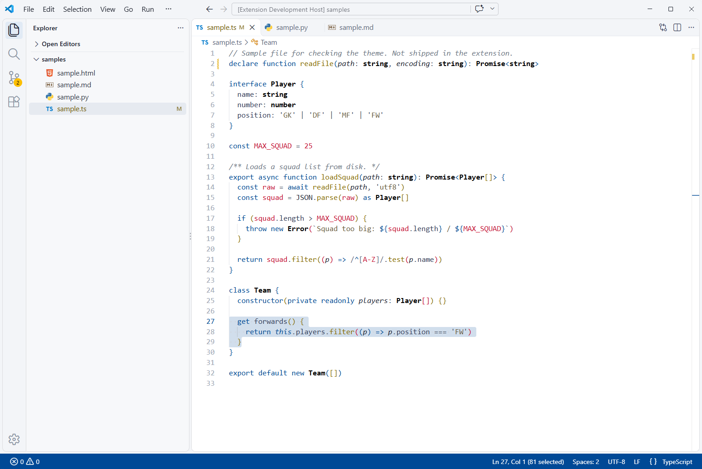
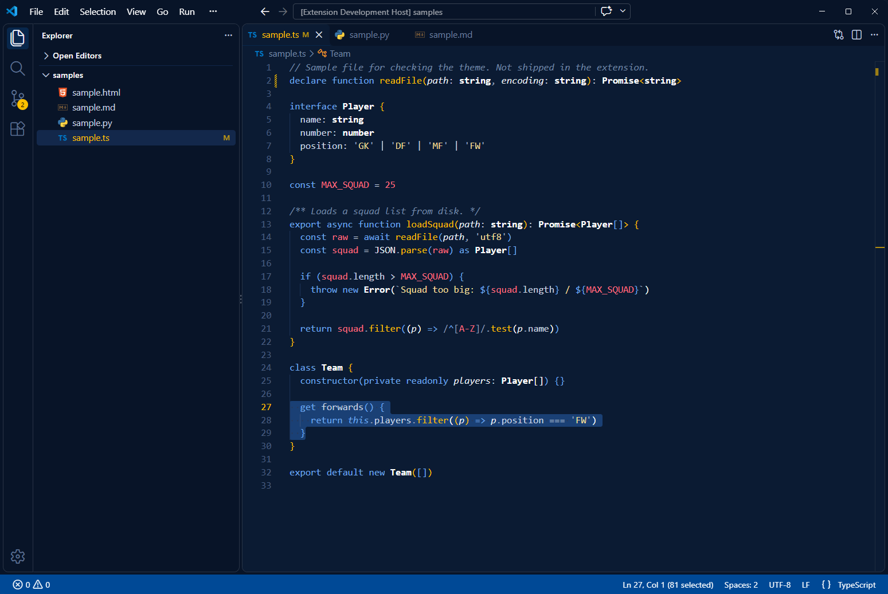
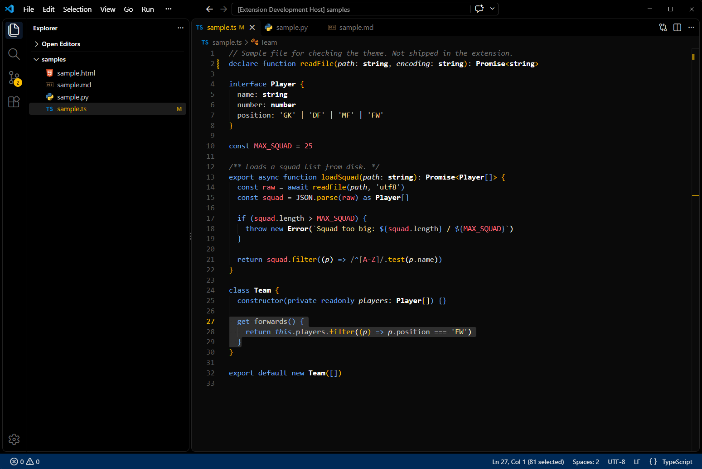

# Los Blancos

A crisp white theme for VS Code in blue, gold and red, with Navy and Blackout dark variants. Made by The DevLab.



## Install

1. Open the Extensions view (`Ctrl+Shift+X` / `Cmd+Shift+X`).
2. Search for **Los Blancos** and click **Install**.
3. Open the Command Palette, run **Preferences: Color Theme** and pick a variant.

## Variants

| Theme | Style |
|---|---|
| **Los Blancos** | Light: white background, blue accents and a blue status bar. |
| **Los Blancos Navy** | Dark navy, with a blue status bar and gold highlights. |
| **Los Blancos Blackout** | Near-black throughout, with a dark blue status bar. |

### Los Blancos Navy



### Los Blancos Blackout



## Palette

| Role | Los Blancos | Navy | Blackout |
|---|---|---|---|
| Background | `#FFFFFF` | `#0B1B33` | `#0A0A0A` |
| Sidebar & panels | `#F7F8FA` | `#081428` | `#000000` |
| Text | `#1A1F2B` | `#E8EDF5` | `#E8E8E8` |
| Status bar | `#004996` | `#004996` | `#002A57` |
| Cursor | `#004996` | `#FCBF00` | `#FCBF00` |
| Badges | `#FCBF00` | `#FCBF00` | `#FCBF00` |
| Keywords, tags | `#004996` | `#6FA8F0` | `#6FA8F0` |
| Functions, attributes | `#8A6D00` | `#FCBF00` | `#FCBF00` |
| Strings | `#6B5B3A` | `#F5DC9A` | `#F5DC9A` |
| Numbers, constants | `#C8102E` | `#FF6B7F` | `#FF6B7F` |
| Types, classes (bold) | `#000000` | `#FFFFFF` | `#FFFFFF` |
| Comments (italic) | `#6E7787` | `#7388A6` | `#7A7A7A` |

## Development

Press F5 in VS Code to open a test window with sample files. The Blackout variant is generated from the Navy theme; after changing `themes/los-blancos-navy-color-theme.json`, run:

```powershell
powershell -File scripts/make-blackout.ps1
```

## Feedback

Spotted something that looks off in your language? Open an issue with a screenshot.

## License

MIT
